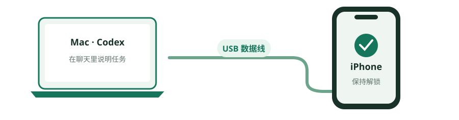
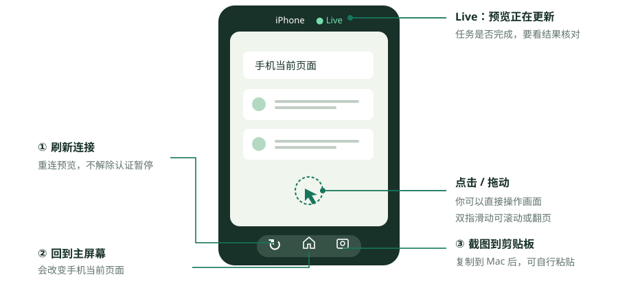
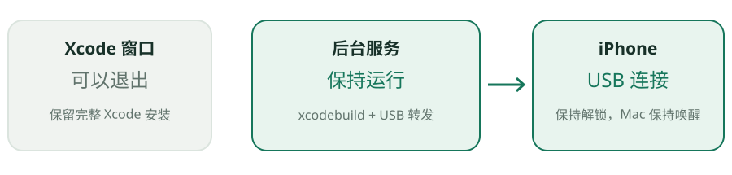
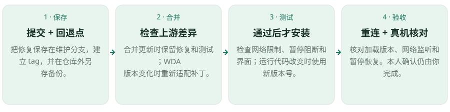

# iPhone Use 简明使用手册

适用：本机修复版 **0.3.13**。安装、设备配对和签名已完成，日常不用重装。

[下载 PDF](iPhone-Use-图文使用手册.pdf) · [HTML 图文版](index.html)

GitHub 可直接阅读本页及图示；HTML 下载到本机后可在浏览器中查看，并复制示例指令。

## 1. 开始使用

**USB 接线 → 解锁 iPhone → 在 Codex 说明任务。**



原版和本机修复版均通过 USB 控制手机，手机仍可用 Wi-Fi 上网。安装时的原版 0.3.12 的底层 WDA 默认监听所有网络接口，可能额外暴露到局域网；本机修复版把手机端控制和屏幕流服务限制为回环地址，保留 USB 通道。不是从 Wi-Fi 控制改成 USB 控制。

可直接发送：

> 用 iPhone Use 连接我的手机，复用现有配置，检查可用后打开手机屏幕。

Codex 会检查服务。`ready=true` 表示手机通道可用。侧边栏的 **Live** 只表示预览更新，不证明 App 已登录或任务已完成。

## 2. 侧边栏怎么用



- 点击画面：点按手机。
- 拖动或双指滑动：滚动、翻页。
- 底部左侧：刷新预览连接。不能解除认证暂停。
- 底部中间：回到手机主屏幕。
- 底部右侧：把截图复制到 Mac 剪贴板。

Codex 执行任务时，尽量不要同时操作。需要自己接手时，先说“暂停手机访问，我来操作”。

## 3. 怎么下指令

说清：**App、任务、范围、限制、输出结果。**

> 在【App】完成【任务】，范围是【日期或条数】。不要【限制】。最后给我【表格或结论】，并核对【关键字段】。

例子：

> 打开小宇宙，整理我最近收藏的 5 期节目，列出标题和主播。只读取，不取消收藏；读不到的字段标为未获取。

> 打开 iPhone 的通知设置，查看微信当前的通知选项，解释各项作用。先不修改设置。

> 在备忘录新建“周末采购”，内容为“牛奶、鸡蛋、咖啡豆”。完成后核对标题和内容，不改已有笔记。

示例需对应 App 已安装，且目标页面可访问。部分列表或缺失字段应明确标注。

## 4. 登录与 Face ID

**App 要求认证 → Codex 暂停 → 你在手机认证 → 聊天回复“已完成继续” → Mac 点击“恢复手机访问” → Codex 继续。**

密码、解锁码和验证码只在手机上输入，不发到聊天。暂停时，预览清空，读取和动作被阻断。刷新或普通“继续”不能代替 Mac 本机确认；选择“保持暂停”会继续阻断。

本人完成密码、验证码和 Face ID 是原版已有的规则。原版 0.3.12 暂停预览时保留旧画面并加遮罩；本机修复版新增清除旧画面、在插件代码中阻断读取和操作，以及恢复前的 Mac 本人确认。

如果只是手机锁屏，亲自解锁后回复“已完成继续”。Codex 会重新检查，并解除对应锁屏暂停；App 认证暂停仍要本人确认。

主动接管可说：

> 暂停手机访问，我要自己登录。等我完成后，再请求恢复。

## 5. 常见问题

| 情况 | 处理 |
|---|---|
| 没有新工具 | 重连或新开 Codex 聊天。 |
| 等待解锁 | 解锁手机、保持唤醒，回复“已完成继续”。 |
| access_paused | 完成认证，再在 Mac 窗口确认恢复。 |
| 未连接 | 检查 USB 与解锁状态，让 Codex 复用配置恢复。 |
| 有画面但任务失败 | 请 Codex 按实际错误检查；Live 不是任务完成证据。 |
| 签名过期 | 让 Codex 使用现有 Personal Team 重建；系统认证由你完成。 |

恢复连接可说：

> iPhone Use 当前连接有问题。请先检查状态，复用现有配置和有效构建，按实际错误修复，再验证 ready=true。不要重复执行刚才可能已生效的动作。

当前为本地修复版。升级插件前，先让 Codex 核对两项 P0 修复是否保留。

## 6. 结束使用

先核对 App、日期、条数和关键内容。发送或提交结果不确定时，先查记录，不直接重做。

> 本次任务结束。请停止本次 iPhone Use 服务，并确认已停止；不要删除 App 或手机数据。

确认停止后即可拔线。**关闭侧边栏不等于停止服务。**


## 7. Xcode 可以关闭吗？

**可以关闭窗口，也可以退出 Xcode。** 本插件使用独立的后台 `xcodebuild` 进程运行手机服务，不依赖 Xcode 图形界面。



| 操作 | 影响 |
|---|---|
| 关闭窗口或退出 Xcode | 插件启动的后台服务可以继续运行。 |
| 结束 `xcodebuild` 或 USB 转发 | 会使手机通道停止。 |
| 卸载 Xcode、Mac 睡眠或拔 USB | 会影响构建、启动或连接。 |
| 管理 Apple 账号、证书或设备 | 需要时再打开 Xcode。 |

保留完整 Xcode 安装，使用时让 Mac 唤醒并接好 USB。结束使用时让 Codex 停止服务。

**手动启动的例外：**如果通过 Xcode 的 **Product → Test** 启动 WDA，它由该测试会话管理。停止测试会停止其服务；先让 Codex 检查归属，再改用插件启动。

> 请确认 iPhone Use 是由插件后台任务启动，并检查 ready=true。确认后我会退出 Xcode 窗口，继续使用手机。

## 8. 升级时怎样保留两项 P0？

**安装新版不会自动保留本地修复。** 必须保留 WDA 回环监听，以及认证暂停阻断、清屏和本人确认恢复。



1. **保存：**把修复提交到维护分支，建立回退 tag，在仓库外另存备份。
2. **合并：**检查上游差异，保留修复和回归测试；WDA 版本变化时重新适配补丁。
3. **测试：**检查网络限制、暂停阻断和界面，通过后再安装。运行代码改变时使用新版本号。
4. **验收：**重连聊天，核对实际加载版本、`ready=true`、`network_hardened=true`、控制与屏幕流的 USB 回环端点，以及暂停和恢复行为。

**没有新提交且安装代码一致时，保留现状。** 不重装，不重建 WDA。仅更新手册也不需要重启手机服务。`ready=true` 单独不能证明两项修复保留。

> 请按 UPGRADE.md 升级 iPhone Use：先保存维护分支和回退点，检查上游差异，保留两项 P0 修复及测试。测试通过后再安装，必要时提示我重连，并核对真机网络与暂停保护；没有更新就保留现状。

维护分支：`codex/iphone-use-p0-security`。详细命令见 [升级维护流程](../../UPGRADE.md)。

**2026-10-14 记录：**维护提交 `2c692f4`。当时上游没有新提交，484 项 Python 测试、60 项界面测试通过，61 个安装文件一致。真机 READY 和回环端点已核对。本人确认弹窗的人工验收记录为 2026-10-13；历史结果不能代替下一次升级验收。

## 9. 怎样从备份恢复？

**恢复到新目录，核对后再安装。不要直接覆盖当前工作。**


本次已验证的恢复点：

- 提交：`2c692f46fb60246b1bff83727b898c86d8838121`
- 标签：`iphone-use-local-0.3.13-p0-20261014-r1`
- 本次安装机器上的目录：`~/Downloads/Codex/iphone-use-backups/20261014-104535-maintenance/`
- 文件：`iphone-use-p0-maintenance-final.bundle`

该 bundle 已在新目录克隆，并核对全部 Git 跟踪文件。其他电脑请使用实际备份路径；备份需要另行保存，不能只保留本页上的名称。

在备份目录打开终端，可让 Codex 执行以下命令；目标目录应尚不存在：

```sh
git bundle verify iphone-use-p0-maintenance-final.bundle
git clone --branch codex/iphone-use-p0-security \
  iphone-use-p0-maintenance-final.bundle iphone-use-restored
cd iphone-use-restored
git rev-parse HEAD
sh scripts/install.sh
```

核对提交后再安装。重连聊天，复查版本、READY、网络限制和暂停保护。使用源码 ZIP 时，解压到新目录后运行 `sh scripts/install.sh`。

不同 WDA 版本的构建未必通用，按检查结果决定是否重建；继续使用你自己的设备、Personal Team 和有效签名配置。

> 请从已验证的 iPhone Use 备份恢复到新目录，核对提交和文件后安装。保留现有工作、手机数据和签名配置；重连后检查 READY、网络限制和暂停保护。

**备份不是自动防覆盖。** 维护分支用于保留和合并修复，仓库外备份用于恢复。签名私钥、手机数据和运行目录不在这份源码备份中。

---

更新日期：2026-10-14。适用版本为本地 0.3.13，不能将其行为直接套用到未修复的上游版本。参见 [网络防护说明](../../NETWORK_SECURITY.md) 和 [升级维护流程](../../UPGRADE.md)。

导出 PDF：在 macOS 上使用装有 `reportlab`、`lxml` 的 Python 运行 `python3 docs/user-guide/export_pdf.py`。默认使用系统黑体字体，输出到 `output/pdf/`，并同步本目录的发布副本。
